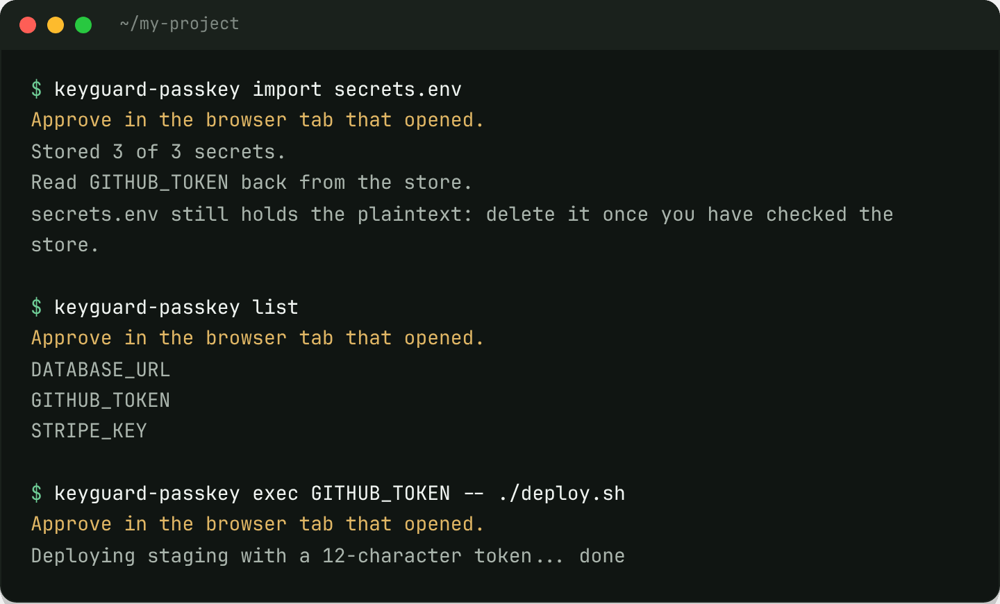
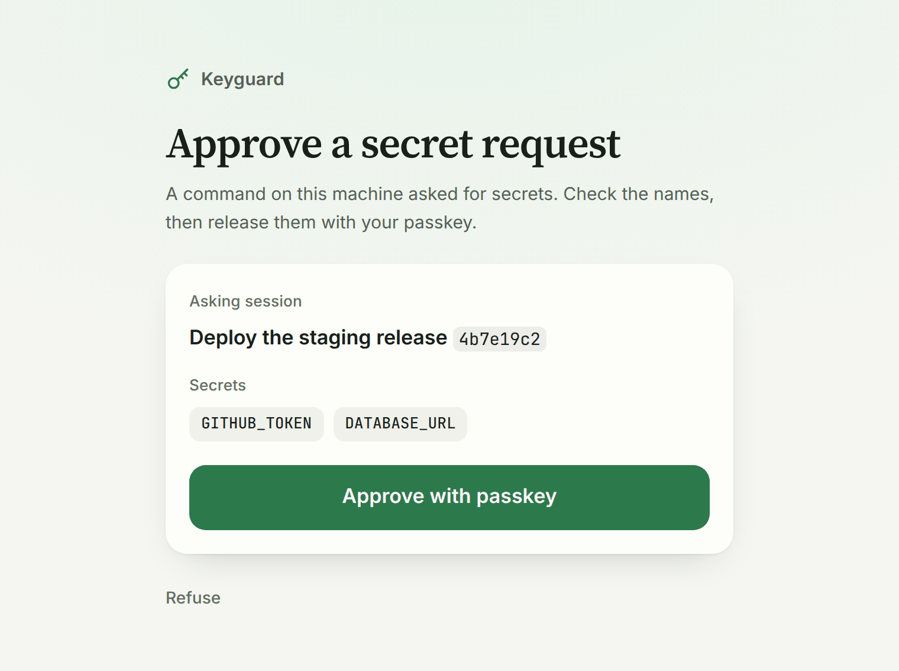
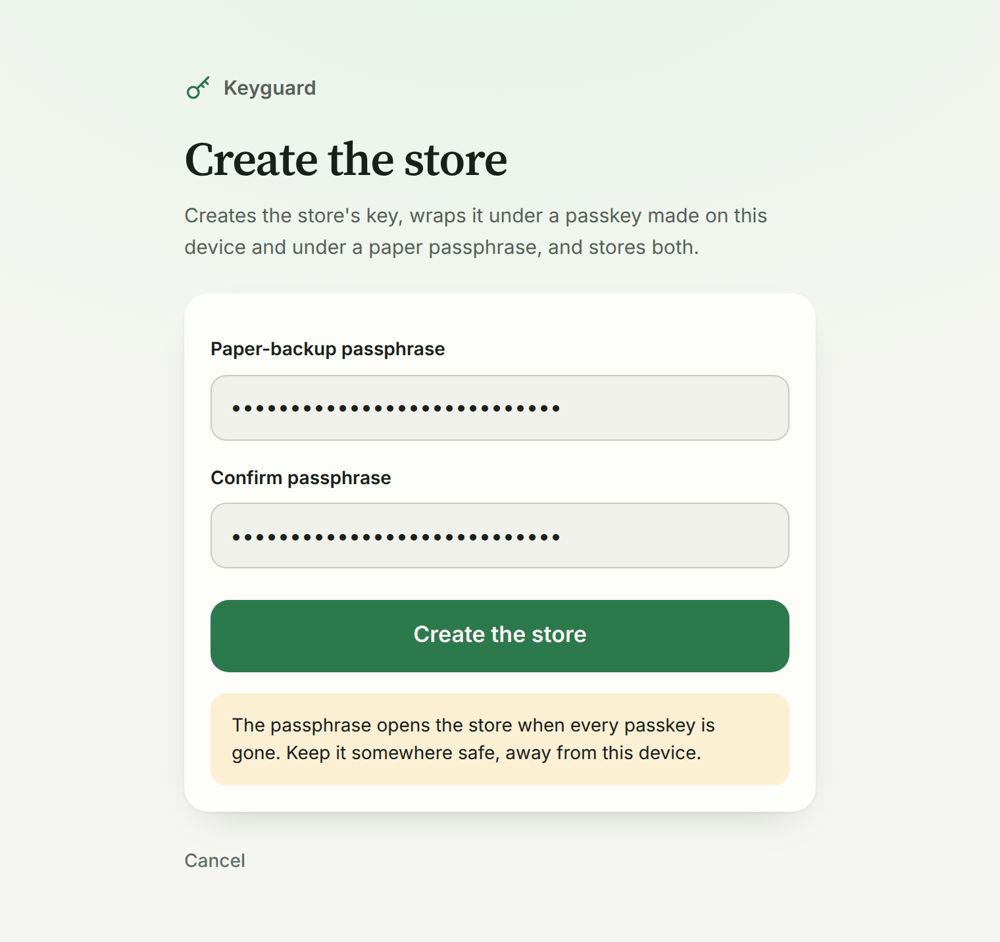
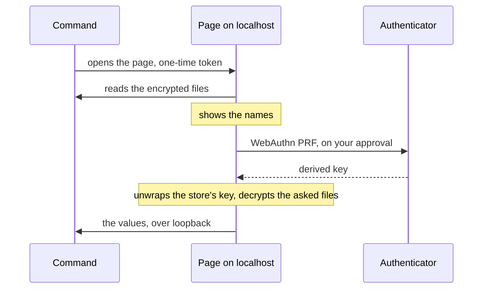

# keyguard-passkey

Secrets in an encrypted store that a passkey opens. One Python command and a browser: no server, no account, no extra binary. For Windows, macOS and Linux.



A command asks for secrets by name. A page on `localhost` shows the names, you approve with Touch ID, Windows Hello, a phone or a security key, and the command gets the values. The files on disk stay encrypted the whole time.

<picture>
  <source media="(prefers-color-scheme: dark)" srcset="docs/images/approve-dark.png">
  
</picture>

A machine without a browser, such as a dev box or a container, asks through the optional unlock service, and you approve on your phone ([Approve on Your Phone](#approve-on-your-phone)).

## Requirements

- Python 3.9 or later. The client uses the standard library only.
- A browser with WebAuthn and the PRF extension, and an authenticator that it can reach.
- Only to ask through the unlock service: `age` and OpenSSL 3 on the asking machine.

| System | Browser and authenticator | State |
|---|---|---|
| macOS | Chromium 157 (Arc) with Touch ID | works, measured 2026-11-12 |
| Windows 11 | Edge or Chrome 147 or later with Windows Hello | not measured yet |
| any | Safari, Firefox, a security key, a phone | not measured yet |

A browser without an authenticator, or without PRF, gets a message that names what to set up. The page does not start a passkey request there. A refused prompt shows the reason the browser gave, and says when an extension has taken over passkey requests. KeePassXC-Browser with its passkeys option on is one: KeePassXC refuses this page's request, whose challenge is shorter than the 16 characters it requires.

Creating the store takes two passkey prompts, and adding a device three. Safari and Zen on macOS refuse a prompt that follows another without a click in between (seen 2026-11-17), so the page then asks for a click on Continue.

## Install

From a checkout, with nothing to build:

```bash
git clone https://github.com/emazzotta/keyguard-passkey.git
python3 keyguard-passkey/keyguard-passkey version
```

Or as a command on your `PATH`, at a release:

```bash
uv tool install git+https://github.com/emazzotta/keyguard-passkey@v0.7.3
keyguard-passkey version
```

`pipx install` takes the same address, and both tools also install from a checkout (`uv tool install ./keyguard-passkey`).

[docs/updating.md](docs/updating.md) has the update step for each install, and the way to keep a pinned copy in another repository.

## From a `.env` File to an Encrypted Store

```bash
keyguard-passkey init                 # a passkey and a paper passphrase, once
keyguard-passkey import secrets.env   # encrypt every NAME=value line
keyguard-passkey list                 # check the names
keyguard-passkey exec API_TOKEN -- ./deploy.sh
```

<picture>
  <source media="(prefers-color-scheme: dark)" srcset="docs/images/init-dark.png">
  
</picture>

`import` reads one value back from the store before it reports success. It never deletes the plaintext file: delete it yourself once the store has what you need. A name that the store already holds keeps its value unless you pass `--force`. A `base64:` value, as `get` prints it, is stored decoded.

Keep the paper passphrase away from the machine. It opens the store when the passkey is gone.

## Commands

| Command | Result |
|---|---|
| `init` | Creates the store, its passkey and its paper passphrase |
| `get NAME... [--format shell]` | Prints one `NAME=value` line per name, or `export NAME='value'` lines |
| `list` | Prints the names, never a value |
| `set NAME` | Stores the value from standard input |
| `rm NAME` | Removes a secret |
| `import FILE [--force]` | Stores every `NAME=value` line of a `.env` file, or of standard input when `FILE` is `-` |
| `exec NAME... -- COMMAND` | Runs `COMMAND` with the secrets in its environment |
| `sign --target ID --box BOX [--title TITLE]` | Prints a token of the message on standard input, signed with the owner key for one session; service mode only ([docs/service.md](docs/service.md#owner-signatures)) |
| `lock` | Drops the values held from earlier approvals |
| `version` | Prints the version |
| `pending` | Prints this machine's service requests that wait for an approval; `--watch` streams them, `--clear-expired=SESSION` forgets a session's expired ones |
| `serve` | Runs the unlock service ([docs/service.md](docs/service.md)) |
| `verify-install` | Checks a vendored copy against its manifest ([docs/updating.md](docs/updating.md)) |

Each command that reads or changes the store opens one browser tab and needs one approval. `--no-browser` prints the address instead, and `--store FOLDER` selects a store. `--service URL` sends the request to the unlock service instead.

### In Scripts

`exec` is the safe default: only `COMMAND` sees the values, and a name that is already in the environment wins without an approval.

`get` writes to standard output only. A value that holds a line break, or that starts with `base64:`, comes as `NAME=base64:<encoded>`, so decode every value that starts with `base64:`.

| Exit code | Meaning |
|---|---|
| 0 | Done |
| 1 | Error, or the store has a newer format than this release reads |
| 2 | You refused in the browser |
| 3 | No answer: no store, no browser, or no authenticator answered |
| 4 | A name is not in the store |
| 64 | Wrong usage |
| 127 | `exec` did not find the command |

### The Hold

Released values stay in memory for 10 minutes, so the next command for the same names needs no approval. A small process of your user keeps them, writes them nowhere, and exits when it holds nothing. `set`, `rm` and `import` drop the held value of each name they change, and `lock` drops all of them.

### Other Secret Managers

`get`, `list`, `set` and `rm` follow the [provider contract](docs/provider.md): one command, values on standard output, fixed exit codes. A script that calls the command in `KEYGUARD_PROVIDER` works with this store, with `pass` or with 1Password. [providers/](providers) holds a shim for each.

## Settings

| Variable | Meaning | Default |
|---|---|---|
| `KEYGUARD_PASSKEY_STORE` | Store folder | `store` in the config folder |
| `KEYGUARD_PASSKEY_HOLD_SECONDS` | Hold time, at most 600; 0 holds nothing | 600 |
| `KEYGUARD_PASSKEY_STATE_DIR` | Folder for the hold's address file | the config folder |
| `KEYGUARD_SESSION`, `KEYGUARD_TITLE` | The asking session, shown on the page | none |
| `KEYGUARD_CONTAINER` | The host label of the asking container, shown in the service's Telegram notices | none |
| `KEYGUARD_PASSKEY_PRESENCE_DIR` | The folder that shows whether you sit at a screen, which decides whether the service posts a wait notice | `~/.claude/presence` |

The config folder is `%APPDATA%\keyguard-passkey` on Windows and `$XDG_CONFIG_HOME/keyguard-passkey` elsewhere, with `~/.config/keyguard-passkey` as the fallback.

## How It Works



1. The command starts a server on `127.0.0.1` for this one request and opens `http://localhost:<port>` with a one-time token.
2. The page reads the encrypted files from that server and shows what is asked.
3. Your approval makes the authenticator derive a key (WebAuthn PRF). That key unwraps the store's key, which decrypts the asked files in the page.
4. The page hands the values to the command over loopback. The server ends after one answer, or after 5 minutes.

All cryptography runs in the page, with [typage](https://github.com/FiloSottile/typage). The store is a folder of [age](https://age-encryption.org) files:

| File | Content |
|---|---|
| `index.age` | The names and the file of each, encrypted |
| `vars/<hash>.age` | One secret each, padded so its length tells little |
| `identity-remote.local.age`, `.passkey` | The store's key, wrapped by the passkey, and the passkey's handle |
| `identity-remote.paper.age` | The store's key, wrapped by the paper passphrase |
| `meta.json` | A version counter and a SHA-256 per file |

File names carry a salted hash, so the folder does not show the names of your secrets.

## Limits

- Any program that runs as you can serve a look-alike page on `localhost` and ask for the same passkey. The store protects a copied or stolen disk and makes each read an approval. It does not stop code that already runs under your user.
- The passkey wrap uses typage's `age-encryption.org/fido2prf` stanza, which has no published specification yet. The paper passphrase is the way out of a format change.
- The client has no recovery command yet. `identity-remote.paper.age` is an age passphrase file. Tested: the key inside it decrypts the secret files with the stock `age` command.
- Windows is not measured: neither Windows Hello nor the start of the hold process.

[SECURITY.md](SECURITY.md) says what the store protects and how to report a vulnerability in private.

## Approve on Your Phone

```bash
keyguard-passkey --service https://keyguard.example.ts.net --requester devbox get API_TOKEN
```

The command signs the request and prints a link. You open it on your phone and approve with the passkey there. The page checks the signature against the key you pinned for that machine, then seals the values to a key that only the asking command holds. The service keeps the encrypted store and the open requests, never a key that opens them.

The service runs from the image `ghcr.io/emazzotta/keyguard-passkey`, for amd64 and arm64, behind a proxy that signs you in, such as Tailscale Serve. [docs/service.md](docs/service.md) has the setup, the settings and the HTTP API.

## Development

```bash
uv sync --locked
uv run --locked pytest
uv run --locked ruff check
uv run --locked mypy
bun test ./tests    # the page code, with the bun release that tools/typage/.bun-version names
```

The browser tests drive every command through the page in Chromium with a virtual authenticator. They skip without Playwright:

```bash
uv run --locked --with playwright==1.63.0 playwright install chromium-headless-shell
uv run --locked --with playwright==1.63.0 pytest tests/test_end_to_end.py
```

`spike/localhost-passkey` is the probe that measures one browser and authenticator.

## Third-Party Code

`keyguard_passkey/pages/typage.js` is a bundle of [typage](https://github.com/FiloSottile/typage) 0.3.1 (BSD-3-Clause) and of its dependencies from the noble and scure packages (MIT). [typage.LICENSES.txt](keyguard_passkey/pages/typage.LICENSES.txt) beside it holds each licence.

The bundle is the output of one command, so you can check that the file holds nothing else:

```bash
python3 tools/build_typage.py --check    # needs the bun release that tools/typage/.bun-version names
```

`tools/typage/bun.lock` pins every package with its checksum. The pipeline runs the same check on every change, and a new bundle is a commit that `python3 tools/build_typage.py` makes.

## Related

[keyguard](https://github.com/emazzotta/keyguard) is the macOS tool that this client comes from: a Swift command with Touch ID and an HTTP API for containers. `keyguard-passkey` writes the same store layout, and its [provider contract](docs/provider.md) comes from keyguard's commands and exit codes. One store that both tools open is not tested yet.

## License

[MIT](LICENSE). The bundled typage code keeps its own licences, see Third-Party Code.
