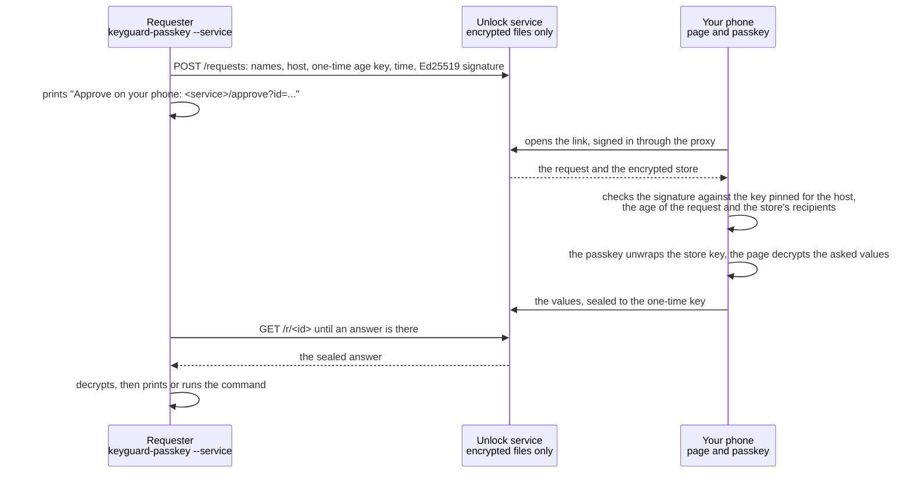
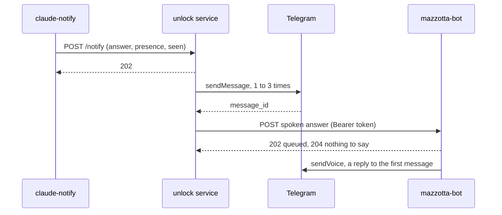
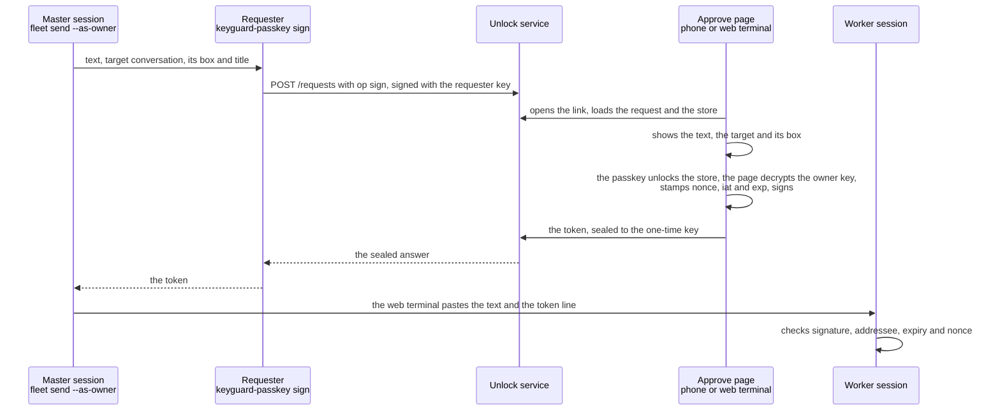

# Run the Service

The unlock service lets a machine without a browser or an authenticator, such as a dev box, a container or a server, ask for secrets that you approve on your phone. The service keeps the store's encrypted files and the open requests. It never holds a key that decrypts them.

## How a Request Travels



The phone keeps two things in its own browser storage, out of the service's reach: the public signing key of each machine, and the store's recipients. A service that forges a request or swaps the store's recipients gets a refusal on the phone.

## Start It

With Docker, on the machine that runs the proxy:

```bash
(umask 077 && openssl rand -hex 32 > request-token)
docker run -d --name keyguard-passkey --restart unless-stopped \
  -p 127.0.0.1:8080:8080 -v keyguard-passkey:/store \
  -e KEYGUARD_PASSKEY_ALLOWED_LOGINS=you@example.com \
  -e KEYGUARD_PASSKEY_REQUESTERS='devbox=dev box' \
  -e KEYGUARD_PASSKEY_REQUEST_TOKEN="$(cat request-token)" \
  ghcr.io/emazzotta/keyguard-passkey:0.7.2
```

Each machine that asks gets a copy of `request-token` ([First Setup](#first-setup)).

The image is for `linux/amd64` and `linux/arm64`. It runs as user 1001 with the store in `/store` and answers `GET /healthz` with 204. A main-branch image is also tagged `YYYYMMDDHHMMSS-<commit>`, for tools such as Flux that follow the newest tag.

Without Docker, from a checkout or an installed client:

```bash
KEYGUARD_PASSKEY_STORE=/srv/keyguard-store keyguard-passkey serve
```

## Stop It

`SIGTERM` stops the service, and it exits with code 0. `docker stop` and Kubernetes send it. The service:

1. closes its port, so a new connection is refused;
2. lets each call in progress finish with its normal answer;
3. stops the expiry sweep and the heartbeat;
4. exits.

A call is in progress from the moment the service accepts its connection until it has sent the answer. Every call is short: it reads or writes the store or the queue in memory, and answers. No call waits for a person, and a commit to the store is a call like any other, so a stop never cuts one in half.

A request that waits for your approval is an entry in the queue, not a call in progress. The asking machine reads it every 2 seconds, and the page makes its calls before and after you approve, never during. A stop therefore never waits for an approval, and the queue goes with the process, as at any restart ([HTTP API](#http-api)).

The service sets no deadline of its own. A client that opens a connection and sends nothing keeps the stop waiting until the socket timeout of 30 seconds. The platform's kill ends what is left, after 30 seconds by default in Kubernetes.

## Put It Behind a Proxy

The service trusts one header to name the signed-in user, `Tailscale-User-Login` by default. Every page call that reads or changes the store needs it. So two rules apply:

- Only the proxy may reach the port. Keep the service on `127.0.0.1` or on a network that only the proxy reaches. A caller that reaches the port directly can send any header value.
- The proxy sets the header and removes a value that the client sends.

[Tailscale Serve](https://tailscale.com/kb/1312/serve) does both: it sets `Tailscale-User-Login` to the visitor's tailnet login and removes the identity headers that come with the request. It sets no header for tagged devices or Funnel traffic, so the pages refuse those. A tagged machine can still ask with the request token.

```bash
tailscale serve --bg 8080
```

Another proxy needs the same behaviour, and `KEYGUARD_PASSKEY_IDENTITY_HEADER` set to its header. Set `KEYGUARD_PASSKEY_ALLOWED_LOGINS`: when it is empty, every login that the header carries may approve.

## Settings

| Variable | Meaning | Default |
|---|---|---|
| `KEYGUARD_PASSKEY_STORE` | The store folder | `store` in the config folder; `/store` in the image |
| `KEYGUARD_PASSKEY_BIND` | The address to listen on | `127.0.0.1`; `0.0.0.0` in the image |
| `KEYGUARD_PASSKEY_PORT` | The port | `8080` |
| `KEYGUARD_PASSKEY_IDENTITY_HEADER` | The header that the proxy fills with the signed-in user | `Tailscale-User-Login` |
| `KEYGUARD_PASSKEY_ALLOWED_LOGINS` | Comma-separated logins that may use the pages | any login |
| `KEYGUARD_PASSKEY_REQUESTERS` | `id=label` pairs, as `devbox=dev box,mac=Mac`: the machines that may ask | none |
| `KEYGUARD_PASSKEY_REQUEST_TOKEN` | The bearer token of the requesters | off: only signed-in callers can ask |
| `KEYGUARD_PASSKEY_REQUEST_RATE_LIMIT` | New requests per minute | `30` |
| `KEYGUARD_PASSKEY_HEARTBEAT_URL` | A push monitor URL, called each minute while `/healthz` answers | off |
| `KEYGUARD_PASSKEY_TELEGRAM_BOT_TOKEN`, `KEYGUARD_PASSKEY_TELEGRAM_CHAT_ID` | Relay the notices posted to `/notify` to a Telegram chat | off |
| `KEYGUARD_PASSKEY_TERMINAL_URL` | The origin of the web terminal, `https://host` with an optional port and no path: an `answer` ping ends with a link to `<origin>/chat/<session>` | off: no link |
| `KEYGUARD_PASSKEY_PUBLIC_URL` | The origin where your phone reaches the service, `https://host` with an optional port and no path: a wait notice ends with a link to `<origin>/approve?id=<id>` | off: no link |
| `KEYGUARD_PASSKEY_SPOKEN_ANSWER_URL`, `UNLOCK_TELEGRAM_BOT_SPOKEN_ANSWER_TOKEN` | Hand each answer to mazzotta-bot at this `http(s)://host[:port][/path]` URL, with the token that both services share under this one name ([Spoken Answers](#spoken-answers)) | off |
| `KEYGUARD_PASSKEY_TOKEN_LABEL`, `KEYGUARD_PASSKEY_IDENTITY_LABEL` | How a notice names a caller with the token or with the header | `token client`, `signed-in device` |

`serve` prints the settings it runs with, without the secrets.

## First Setup

1. **The store.** On your phone, open `<service>/enroll`, name the device and enrol it. On an empty store the page makes a passkey on the phone, creates the store key and asks for a paper passphrase. Keep the passphrase away from the phone. The page shows the store's public key, `age1...`.
2. **Each machine that asks.** In its config folder (`~/.config/keyguard-passkey` on Linux and macOS), write three files, each readable by you only:

   | File | Content |
   |---|---|
   | `sign.key` | A new Ed25519 key: `openssl genpkey -algorithm ed25519 -out sign.key` |
   | `request-token` | The value of `KEYGUARD_PASSKEY_REQUEST_TOKEN` |
   | `remote-recipient` | The store's public key from step 1, needed for `set` |

   Then set `KEYGUARD_PASSKEY_SERVICE` to the service's address and `KEYGUARD_PASSKEY_REQUESTER` to the machine's id from `KEYGUARD_PASSKEY_REQUESTERS`. The flags `--service`, `--requester`, `--signing-key`, `--token-file` and `--remote-recipient` do the same for one command.
3. **The pin.** On the phone, open `<service>/approve?pin=<id>` and paste the machine's public key, which this command prints:

   ```bash
   openssl pkey -in sign.key -pubout -outform DER | tail -c 32 | base64
   ```

   With more than one machine, pin them all at once: choose "All machines" in the Machine list, or open `<service>/approve?pin=*`, and paste one line for each machine, its id, a space and its key:

   ```text
   mac <44-character base64 key>
   devbox <44-character base64 key>
   ```

   - The page lists each line with the machine's name and the first and last 8 characters of its key, and one tap pins every line it can.
   - It pins nothing for a line whose id no machine has, whose key is not 32 bytes in base64, that is not an id and a key, or whose id another line names too.
   - A machine with another key pinned keeps it until you tick Replace on its line. A line whose key is already pinned changes nothing.
   - A request from a machine with no key pinned opens the pin page for that machine first, where "All machines" switches to the paste. Once every line is pinned and the asking machine has its key, the tap goes straight back to the request. Otherwise the page stays to show what it pinned, why each other line was not and which machine the request still waits for, with a link back to the request.
   - The box starts empty. The page never fills it from the service, the link or the keys it holds: a key that came from the service would let a changed service choose whose requests you approve.

4. **A first secret.** `printf %s "$VALUE" | keyguard-passkey set API_TOKEN` prints a link. Open it on the phone and approve. `keyguard-passkey get API_TOKEN` then reads it back the same way.

Another device approves too once it has its own passkey: open `<service>/enroll` on it and choose "Add this device instead".

The asking machine needs `age` and OpenSSL 3 on `PATH`: it signs with OpenSSL and decrypts the answer with `age`. Each approval reveals or changes the asked names only, and `set` and `rm` change one name each. `keyguard-passkey pending` lists the requests of this machine that wait for an approval, and `--watch` streams them as JSON lines for a terminal or status bar. `--clear-expired=SESSION` forgets the requests of that session that expired unanswered, as an answer to a later request of it does: an approver on this machine that answers the session outside the service, such as keyguard's Touch ID, runs it.

## HTTP API

| Endpoint | Caller | Proof |
|---|---|---|
| `GET /healthz` | Monitors | none |
| `GET /approve`, `GET /enroll` and their scripts and stylesheet | The browser | none: the data they load needs the header |
| `GET /config`, `GET /store/meta`, `GET /store/<file>`, `POST /store/commit` | The page | identity header |
| `GET /r/<id>/request`, `POST /r/<id>/response` | The page | identity header |
| `POST /requests`, `GET /r/<id>`, `DELETE /r/<id>` | The asking machine | request token or identity header |
| `POST /notify` | Scripts | request token or identity header |

A request expires after 5 minutes. The service keeps open requests in memory only, so a restart drops them, and the asking command reports that the service no longer holds its request. `POST /requests` also takes an unsigned `notify` field, which only the notices use ([Keyguard Notices](#keyguard-notices)).

## Session Pings

`POST /notify` relays a ping from a Claude Code session to the Telegram chat in `KEYGUARD_PASSKEY_TELEGRAM_CHAT_ID`. Without a bot token and chat, the service accepts the ping and drops it. The body is a JSON object:

| Field | Value |
|---|---|
| `session` | The session's UUID. A `keyguard_failed` notice may also name it by its first 8 characters, or leave the field out |
| `container` | Optional: the host label of the container that runs the session |
| `title` | Optional: the session's title, at most 4000 characters |
| `text` | 1 to 4000 characters, for `answer` 1 to 100000 |
| `kind` | Optional: `prompt` when the session waits for an answer or an approval, `finished` for a finished reply (the default), `answer` for the whole text of a reply (see Answers), `keyguard_failed` for a keyguard request that got no answer (see Keyguard Notices) |
| `presence` | Optional, `answer` only: `computer`, `phone`, `away` or `unknown`, where the owner was when the answer went out. Any other value is `unknown` |
| `seen` | Optional, `answer` only: the newest use of a web terminal, in epoch seconds, fresh or not. Anything but a whole number from 0 to 999999999999 is no value |

The service answers `202` and sends in the background, `400` for any other body, and `429` past 20 pings a minute. It writes the message itself in Telegram HTML and escapes each value, so a caller cannot add a line or a tag:

```
Claude on dev box

⏳ Waiting for your OK to push 2 commits.

Telegram alert layout · devbox-7f7d78d989-tgd9t · 4a015f0f-199b-4270-9c06-fecc5d85b976
[session 4a015f0f]
```

- The heading is bold. It names the caller from how it authenticated (`KEYGUARD_PASSKEY_TOKEN_LABEL` or `KEYGUARD_PASSKEY_IDENTITY_LABEL`), not from the body, and stops at 60 characters.
- The text opens with ⏳ for a prompt and 💬 for a finished reply. It loses control and format characters and stops at 300 characters.
- The line above the marker holds the title and the container, when the body names them, and the session as code, which a tap copies. The title loses control and format characters like the text and stops at 60 characters.
- The last line is the marker: `[session `, the first 8 characters of the session, `]`. The Telegram bot reads it from the message that a reply quotes, so a reply to any ping goes to its session.

### Answers

`kind` `answer` sends the text of a whole reply, not a one-line ping, with the same body and the same `202`, `400` and `429`. It differs in six points:

- `text` may have 100000 characters, and the service answers `400` above that: the limit only guards the service. A text of more than three messages is not refused: the service sends the start of it and ends the last message with the note `… (cut, full answer in the session)`, above the link and the footer. A text that fits in three messages has no note.
- It keeps the line breaks, with one blank line at most between two paragraphs, and escapes `<`, `>` and `&`.
- It replaces each string that looks like a Telegram bot token with `[redacted]`. This is the pattern of the bot's `src/token_scrubber.py`: the two copies must change together. The service scans only the first 12800 characters, which is more than three messages show, since the pattern is slow on a very long run of digits.
- It splits the text at a blank line, a line break or a space in the last quarter of a message, else in the middle of a line, into at most 3 messages of at most 4096 characters, as Telegram counts them after it parses the HTML. Each message has the heading, a counter such as `(2/3)` after the mark, the footer and the marker, so a reply to any of them continues the session.
- When `KEYGUARD_PASSKEY_TERMINAL_URL` is set, the last message has the link `Open the session in Safari` to `<origin>/chat/<session>`, above the footer. The service builds the link from that setting and the session. A `link` field in the body is ignored. Telegram's own browser cannot use a passkey, hence Safari.
- The messages go one after the other from one background thread. A message that Telegram refuses is logged as `telegram: message 2 of 3 not sent (HTTP 429)`, without its text, and the next one is still sent.

A wrong `presence` or `seen` never costs the answer. The service uses neither: it passes both on to [Spoken Answers](#spoken-answers).

A reply of more than three messages ends like this:

```
Claude on dev box

💬 (3/3) ...the last paragraph that fitted.

… (cut, full answer in the session)

Open the session in Safari

Telegram alert layout · devbox-7f7d78d989-tgd9t · 4a015f0f-199b-4270-9c06-fecc5d85b976
[session 4a015f0f]
```

### Spoken Answers

With `KEYGUARD_PASSKEY_SPOKEN_ANSWER_URL` and `UNLOCK_TELEGRAM_BOT_SPOKEN_ANSWER_TOKEN` set, the service hands each answer to mazzotta-bot, which decides whether to speak it (its UC-014). Without both, it hands over nothing and `serve` says `spoken answers off`.



- It hands over an answer only after its messages went out, in the same background thread, so the voice never delays the text.
- It hands over nothing when Telegram took none of the messages: the voice needs a message to reply to.
- The body is `{"session", "text", "presence", "seen", "reply_to"}`: the session's UUID, the text as the messages carry it (redacted and cut like them), the presence (`unknown` when the notice named none), `seen` or `null`, and the id of the first message that Telegram took.
- It waits 10 seconds for the bot. Any failure is one line, such as `spoken answer: not sent (HTTP 401)`, without the text or the token. It never retries.

## Keyguard Notices

The service tells the same Telegram chat what became of an unlock request when you may not have seen it. It writes these notices with the marks, the marker and the container label of a ping, but they have no `Claude on ...` heading: the message opens with its mark.

| What happens to a request | The chat gets |
|---|---|
| It opens with a hint that says `away` or `unknown` | One wait notice, at once |
| It opens with a hint that says `computer` or `phone` | Nothing |
| It opens with no hint, from an old client | No wait notice: the service cannot tell where you are, and a notice for each request would be noise |
| It gets an answer, approved or refused | Nothing: the page seals both, so the service cannot tell them apart |
| The requester cancels it (`DELETE /r/<id>`) | Nothing |
| It expires with no answer, whatever the presence | One `❌🔐` line |
| The service restarts while it is open | Nothing: the service keeps requests in memory only |

The service sees an expiry in its sweep, every 15 seconds, or in the next call that purges the queue, so the line comes within about 15 seconds of the 5 minutes. An answered request that nobody collected is not an expiry.

```
🔐 Waiting for your approval: dev box asks to read 2 variables.

Approve in Safari

Plan the migration · devbox-7f7d78d989-tgd9t
[session 4a015f0f]
```

```
❌🔐 Request expired with no answer: dev box asked to read 2 variables.

Plan the migration · devbox-7f7d78d989-tgd9t
[session 4a015f0f]
```

- The text names the requester by its label in `KEYGUARD_PASSKEY_REQUESTERS` (`an unlisted machine` when the id has none), the operation (`read`, `set`, `remove` or `list the variable names`) and the number of variables. It never names a variable.
- The link `Approve in Safari` goes to `KEYGUARD_PASSKEY_PUBLIC_URL/approve?id=<id>`. Without that setting the notice has no link. The service builds it from the setting and the id, never from the request. Telegram's own browser cannot use a passkey, hence Safari.
- The line above the marker holds the request's `title` and its container, when it has them. It has no session code: the service knows 8 characters of the session, not the UUID. The marker is the first 8 characters of the request's signed `session` field. A request with no `session` has no marker, and a reply to its notice has no session to continue.
- These notices do not count against the 20 a minute of `/notify`: the limit on new requests bounds them. A notice that cannot be sent is logged without its text and never fails or delays the request.

### The `notify` Field of a Request

The requester adds an object to the body of `POST /requests`. The signature does not cover it, and neither the page nor the requester sees it again.

```json
{"vars": ["A"], "host": "devbox", "eph_pubkey": "age1...", "ts": 1, "sig": "...",
 "notify": {"presence": "away", "container": "devbox-7f7d78d989-tgd9t"}}
```

| Field | Value |
|---|---|
| `presence` | `computer`, `phone`, `away` or `unknown`. A missing or other value counts as `unknown`, and `unknown` counts as `away` |
| `container` | Optional: the host label of the requester's container, 1 to 63 letters, digits or hyphens. Anything else is dropped |

A wrong `notify` field never costs the request. A request with no `notify` field, or with one that is not an object, comes from an old client: it gets no wait notice, its failure line has no container, and an older service ignores the field. A hint with a missing or wrong `presence` is not that: it counts as `unknown` and posts the wait notice. A requester can claim `computer` to hide the wait notice of its own request, never the line for an expiry. The service learns the Claude session from the signed `session` field (`KEYGUARD_SESSION`, which the devbox wrapper sets). The container label comes from the requester: the client sends `KEYGUARD_CONTAINER`, and a machine that does not set it posts notices with no container.

### Where `presence` Comes From

The client reads `~/.claude/presence/` when it asks, or the folder in `KEYGUARD_PASSKEY_PRESENCE_DIR`. The web terminal writes it.

- The folder holds one file per web-terminal instance. The writer builds `.<instance>.tmp` and renames it over `<instance>`, so the reader skips every file whose name starts with a dot.
- A line is `<epoch-seconds> <kind>`, with kind `computer` or `phone`. It is fresh while `now - epoch < 120`; a line dated in the future is fresh. A line that does not parse is ignored.
- Several files merge. Equal lines may repeat. A file that vanishes between the listing and the read has no lines and is no error. A failed write leaves the last good file, whose lines age out by the 120 seconds.
- The result is `computer` when any fresh line says `computer`, else `phone` when any says `phone`, else `away` (the folder is readable and holds no fresh line), else `unknown` (the folder is missing or unreadable).
- The same rules live in the dotfiles, as `classify(lines, now)` in `bin/presence.py`. Change them in both.

### Posting a Failure Line from Outside

The Mac keyguard server asks for secrets without this service, so it posts its own failure line with `POST /notify`, with the same proof as any ping: `kind` `keyguard_failed`.

| Field | Value |
|---|---|
| `kind` | `keyguard_failed` |
| `text` | 1 to 4000 characters, shown up to 300 |
| `session` | Optional: 8 letters or digits, or a full UUID. Leave it out, or send `null`, when the requester has no Claude session |
| `container` | Optional: a host label |
| `title` | Optional: at most 4000 characters, shown up to 60. The caller names itself here, for example `Mac keyguard`: the message has no heading and no origin |

```json
{"kind": "keyguard_failed", "session": "4a015f0f", "container": "devbox-7f7d78d989-tgd9t",
 "title": "Mac keyguard", "text": "No answer to a request for 2 variables."}
```

```
❌🔐 No answer to a request for 2 variables.

Mac keyguard · devbox-7f7d78d989-tgd9t
[session 4a015f0f]
```

- The answers are `202`, `400` and `429` of a ping, and the 20 a minute are shared with the pings.
- The message has no heading and opens with `❌🔐`. The code of the session appears only for a full UUID, and the marker only when the body names a session. A body with no session, title and container is the text alone.
- The service refuses `keyguard_wait` with `400`: only the service posts it, because it decides from the presence. Post a failure line only for a request that this service does not hold, or the chat gets two.

## Owner Signatures

A requester can ask you to sign a short message as the owner, such as `yes, push personal-infra 06be524c`, for one Claude Code session that waits for your yes. The approve page signs it with the owner key. Only the page and the Mac's keyguard can decrypt that key, and no read releases it. The session checks the signature against the pinned public key before it acts on the text.



### The Request

`POST /requests` with `op` `sign`, an empty `vars` and these fields, which the requester signs with the others:

| Field | Value |
|---|---|
| `text` | The message: 1 to 1000 characters. Line breaks are allowed; other control characters, format, private-use and surrogate characters, line and paragraph separators, every default-ignorable code point (which draws as nothing, such as a variation selector), and every blank but the plain space (U+0020), such as a no-break space or the braille blank, are not |
| `target` | The full conversation id of the session it is for: a Claude Code UUID, an opencode `ses_` id or `agy_` and an agy UUID |
| `target_box` | That session's box as the web terminal names it: 1 to 63 letters, digits or hyphens |
| `target_title` | Optional: its title, under the rules of `title` |

The service answers `400` to any other shape, a `value` included. The page refuses a request that breaks these rules, since it could not show it whole.

### The Page

- It shows `Sign a message as you`, the asking machine and session as for any request, the whole text with its line breaks, and `To <target_title> (<short id>) on <target_box>`: the first 8 characters of a Claude Code or agy UUID, the last 8 of an opencode id.
- Approve unlocks the store with the passkey and decrypts `KEYGUARD_OWNER_SIGNING_KEY`, an Ed25519 private key in PKCS #8 PEM. The page builds the payload, signs it and answers the token, sealed to the request's one-time key. The answer holds nothing else, and one approval signs one payload.
- A store without the key gets the answer `absent` with `KEYGUARD_OWNER_SIGNING_KEY`, and the client exits 4, as `get` does for a missing name.

### The Token

`<payload>.<signature>`, both base64url without padding. The payload is the UTF-8 JSON that the page wrote, signed as these exact bytes:

```json
{"v":1,"text":"yes, push personal-infra 06be524c","to":{"conversation":"212df38e-7c4b-4a51-9d0e-3f6b2a8c1e57","box":"macbook"},"nonce":"q8Xz3VYc0mJr2t9bWk1fLg","iat":1795000000,"exp":1795000600}
```

- The requester supplies `text` and `to`. The page sets `nonce` (16 random bytes), `iat` (the moment you approve) and `exp` (`iat` + 600 s) itself.
- `target_title` stays out: it helps you recognise the session and proves nothing.
- A checker accepts the token only when the signature matches the pinned owner key, `to.conversation` is its own conversation, `iat` is at most 60 s ahead of its clock, `exp` lies in the future and at most 600 s after `iat`, and it has not seen the `nonce` before.

### The Owner Key

- `KEYGUARD_OWNER_SIGNING_KEY` is a variable of the store that no read releases. With a service, the client and the service refuse a `get`, `set` or `rm` request that names it. In every mode the page refuses it in each of those approvals (`exec` included), so a session can neither read nor replace it. `list` names it.
- The Mac's keyguard refuses it the same way and creates it (keyguard `README.md`, Owner Signatures).

### The Client

`keyguard-passkey sign --target <id> --box <box> [--title <title>]` reads the text on standard input, asks as above and prints the token. It turns hidden characters in the title into spaces and cuts it at 80 characters, so a long title never costs the approval. Its exit codes are those of `get`. `pending` lists a sign request with its `text`, `target`, `target_box` and `target_title`, and an empty `vars`. The keyguard notices name the operation `sign a message`.

## Limits

- The service serves the pages. Whoever can change the service's files or image can change the code that decrypts on your phone. The pinned keys stop a forged request, not a changed page. Run the image of a release tag, and keep the service where only you can change it.
- A copy of the store folder holds encrypted files only. It opens with the passkey or with the paper passphrase.
- The pins live in one browser's storage. A new phone, or a cleared browser, pins each machine again. On iOS, a Home Screen web app opens a link to another site, such as an approve link, in its own sheet (Safari View Controller), whose storage is not Safari's: pin each machine there too. Its pins stay after the sheet and the app close.
- A sign request shows the target's title as the requester sent it. The checker binds the conversation id, not the title.
