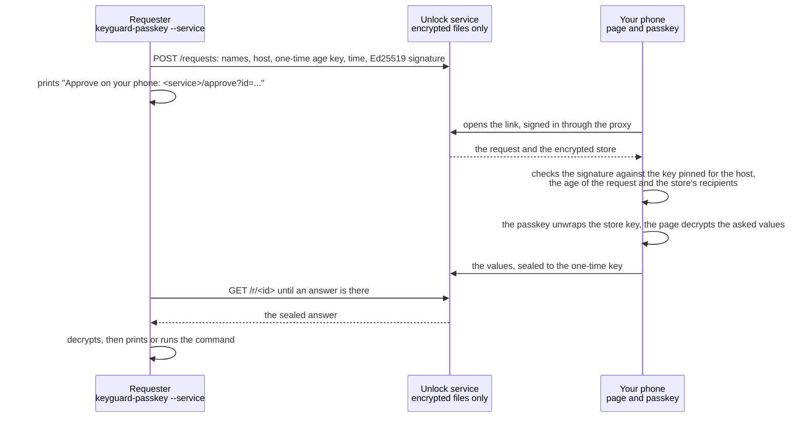

# Run the Service

The unlock service lets a machine without a browser or an authenticator, such as a dev box, a container or a server, ask for secrets that you approve on your phone. The service keeps the store's encrypted files and the open requests. It never holds a key that decrypts them.

## How a Request Travels



The phone keeps two things in its own browser storage, out of the service's reach: the public signing key of each machine, and the store's recipients. A service that forges a request or swaps the store's recipients gets a refusal on the phone.

## Start It

With Docker, on the machine that runs the proxy:

```bash
(umask 077 && openssl rand -hex 32 > request-token)
docker run -d --name keyguard-passkey --restart unless-stopped \
  -p 127.0.0.1:8080:8080 -v keyguard-passkey:/store \
  -e KEYGUARD_PASSKEY_ALLOWED_LOGINS=you@example.com \
  -e KEYGUARD_PASSKEY_REQUESTERS='devbox=dev box' \
  -e KEYGUARD_PASSKEY_REQUEST_TOKEN="$(cat request-token)" \
  ghcr.io/emazzotta/keyguard-passkey:0.3.2
```

Each machine that asks gets a copy of `request-token` ([First Setup](#first-setup)).

The image is for `linux/amd64` and `linux/arm64`. It runs as user 1001 with the store in `/store` and answers `GET /healthz` with 204. A main-branch image is also tagged `YYYYMMDDHHMMSS-<commit>`, for tools such as Flux that follow the newest tag.

Without Docker, from a checkout or an installed client:

```bash
KEYGUARD_PASSKEY_STORE=/srv/keyguard-store keyguard-passkey serve
```

## Put It Behind a Proxy

The service trusts one header to name the signed-in user, `Tailscale-User-Login` by default. Every page call that reads or changes the store needs it. So two rules apply:

- Only the proxy may reach the port. Keep the service on `127.0.0.1` or on a network that only the proxy reaches. A caller that reaches the port directly can send any header value.
- The proxy sets the header and removes a value that the client sends.

[Tailscale Serve](https://tailscale.com/kb/1312/serve) does both: it sets `Tailscale-User-Login` to the visitor's tailnet login and removes the identity headers that come with the request. It sets no header for tagged devices or Funnel traffic, so the pages refuse those. A tagged machine can still ask with the request token.

```bash
tailscale serve --bg 8080
```

Another proxy needs the same behaviour, and `KEYGUARD_PASSKEY_IDENTITY_HEADER` set to its header. Set `KEYGUARD_PASSKEY_ALLOWED_LOGINS`: when it is empty, every login that the header carries may approve.

## Settings

| Variable | Meaning | Default |
|---|---|---|
| `KEYGUARD_PASSKEY_STORE` | The store folder | `store` in the config folder; `/store` in the image |
| `KEYGUARD_PASSKEY_BIND` | The address to listen on | `127.0.0.1`; `0.0.0.0` in the image |
| `KEYGUARD_PASSKEY_PORT` | The port | `8080` |
| `KEYGUARD_PASSKEY_IDENTITY_HEADER` | The header that the proxy fills with the signed-in user | `Tailscale-User-Login` |
| `KEYGUARD_PASSKEY_ALLOWED_LOGINS` | Comma-separated logins that may use the pages | any login |
| `KEYGUARD_PASSKEY_REQUESTERS` | `id=label` pairs, as `devbox=dev box,mac=Mac`: the machines that may ask | none |
| `KEYGUARD_PASSKEY_REQUEST_TOKEN` | The bearer token of the requesters | off: only signed-in callers can ask |
| `KEYGUARD_PASSKEY_REQUEST_RATE_LIMIT` | New requests per minute | `30` |
| `KEYGUARD_PASSKEY_HEARTBEAT_URL` | A push monitor URL, called each minute while `/healthz` answers | off |
| `KEYGUARD_PASSKEY_TELEGRAM_BOT_TOKEN`, `KEYGUARD_PASSKEY_TELEGRAM_CHAT_ID` | Relay the notices posted to `/notify` to a Telegram chat | off |
| `KEYGUARD_PASSKEY_TOKEN_LABEL`, `KEYGUARD_PASSKEY_IDENTITY_LABEL` | How a notice names a caller with the token or with the header | `token client`, `signed-in device` |

`serve` prints the settings it runs with, without the secrets.

## First Setup

1. **The store.** On your phone, open `<service>/enroll`, name the device and enrol it. On an empty store the page makes a passkey on the phone, creates the store key and asks for a paper passphrase. Keep the passphrase away from the phone. The page shows the store's public key, `age1...`.
2. **Each machine that asks.** In its config folder (`~/.config/keyguard-passkey` on Linux and macOS), write three files, each readable by you only:

   | File | Content |
   |---|---|
   | `sign.key` | A new Ed25519 key: `openssl genpkey -algorithm ed25519 -out sign.key` |
   | `request-token` | The value of `KEYGUARD_PASSKEY_REQUEST_TOKEN` |
   | `remote-recipient` | The store's public key from step 1, needed for `set` |

   Then set `KEYGUARD_PASSKEY_SERVICE` to the service's address and `KEYGUARD_PASSKEY_REQUESTER` to the machine's id from `KEYGUARD_PASSKEY_REQUESTERS`. The flags `--service`, `--requester`, `--signing-key`, `--token-file` and `--remote-recipient` do the same for one command.
3. **The pin.** On the phone, open `<service>/approve?pin=<id>` and paste the machine's public key, which this command prints:

   ```bash
   openssl pkey -in sign.key -pubout -outform DER | tail -c 32 | base64
   ```

4. **A first secret.** `printf %s "$VALUE" | keyguard-passkey set API_TOKEN` prints a link. Open it on the phone and approve. `keyguard-passkey get API_TOKEN` then reads it back the same way.

Another device approves too once it has its own passkey: open `<service>/enroll` on it and choose "Add this device instead".

The asking machine needs `age` and OpenSSL 3 on `PATH`: it signs with OpenSSL and decrypts the answer with `age`. Each approval reveals or changes the asked names only, and `set` and `rm` change one name each. `keyguard-passkey pending` lists the requests of this machine that wait for an approval, and `--watch` streams them as JSON lines for a terminal or status bar.

## HTTP API

| Endpoint | Caller | Proof |
|---|---|---|
| `GET /healthz` | Monitors | none |
| `GET /approve`, `GET /enroll` and their scripts and stylesheet | The browser | none: the data they load needs the header |
| `GET /config`, `GET /store/meta`, `GET /store/<file>`, `POST /store/commit` | The page | identity header |
| `GET /r/<id>/request`, `POST /r/<id>/response` | The page | identity header |
| `POST /requests`, `GET /r/<id>`, `DELETE /r/<id>` | The asking machine | request token or identity header |
| `POST /notify` | Scripts | request token or identity header |

A request expires after 5 minutes. The service keeps open requests in memory only, so a restart drops them, and the asking command reports that the service no longer holds its request.

## Limits

- The service serves the pages. Whoever can change the service's files or image can change the code that decrypts on your phone. The pinned keys stop a forged request, not a changed page. Run the image of a release tag, and keep the service where only you can change it.
- A copy of the store folder holds encrypted files only. It opens with the passkey or with the paper passphrase.
- The pins live in one browser's storage. A new phone, or a cleared browser, pins each machine again.
